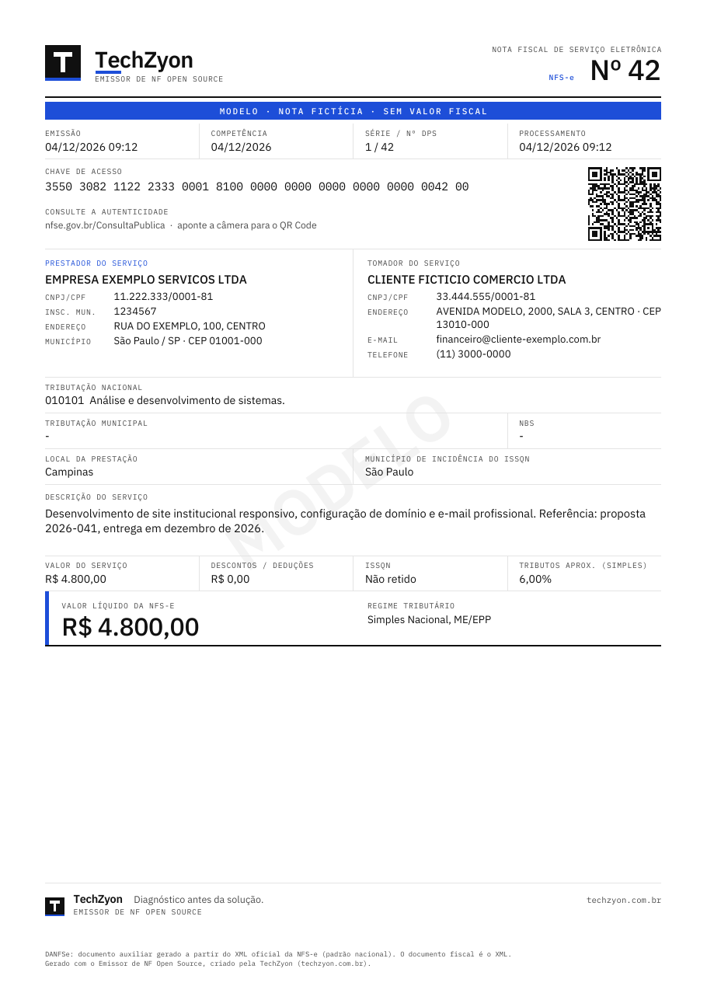

# Emissor de NF Open Source

**Emita NFS-e do padrão nacional com o seu certificado digital, direto do seu computador. Grátis e de código aberto.**

Feito pela **[TechZyon](https://www.techzyon.com.br)** · *Diagnóstico antes da solução.*

---

Cansou de entrar no portal todo mês, digitar os mesmos dados e torcer para não errar? Este emissor conversa direto com a Sefin Nacional (o sistema da Receita Federal que gera a NFS-e) usando o **seu certificado A1**. Você cadastra a empresa, os clientes e um **modelo** de nota uma vez. Depois é escolher o modelo, conferir a prévia e emitir. O XML oficial e um PDF bonito ficam salvos na sua pasta.

- **Seu certificado não sai do seu computador.** Nada vai para nuvem nenhuma. A senha fica no cofre do sistema (Chaves do macOS, Gerenciador de Credenciais do Windows).
- **Vários certificados e várias empresas.** Ideal para contadores: cadastre cada cliente com o certificado dele e escolha na hora de emitir.
- **Modelos de nota.** Cliente, serviço, valor e texto prontos. O texto aceita o mês e o ano de referência automaticamente.
- **Trava erros comuns.** Valor fora da faixa, nota repetida no mês, certificado vencido ou de outro CNPJ, série errada. E nunca envia a mesma nota duas vezes, mesmo se a internet cair no meio.
- **Ambiente de teste.** Comece em homologação: a nota de teste não vale nada e serve para treinar.
- **PDF com a sua marca.** Cada empresa pode ter logo, cores e nome próprios.
- **Pronto para a NT 009** (novo leiaute obrigatório a partir de 01/12/2026) e para o CNPJ com letras.

## Para quem é

Empresas do **Simples Nacional (ME, EPP e MEI)** que emitem NFS-e pelo padrão nacional, e escritórios de contabilidade que emitem para os clientes. Veja os limites em [O que ainda não faz](#o-que-ainda-não-faz).

## Instalar em 3 passos

> **Não entende de programação?** Sem problema. O jeito mais fácil é pedir para uma IA (ChatGPT, Claude, Gemini, Copilot) fazer por você: copie o texto de [PROMPT-PARA-SUA-IA.md](PROMPT-PARA-SUA-IA.md) e cole na IA que você usa. Ela vai te guiar passo a passo.

1. **Baixe o projeto.** Nesta página do GitHub, clique no botão verde **Code** e depois em **Download ZIP**. Descompacte em uma pasta fácil de achar, como `Documentos/Emissor de NF`.
2. **Instale.**
   - **Mac:** abra a pasta e dê dois cliques em `Instalar no Mac.command`. Se o Mac reclamar de "desenvolvedor não identificado", clique com o botão direito no arquivo, escolha **Abrir** e confirme.
   - **Windows:** dê dois cliques em `Instalar no Windows.bat`. Se aparecer "O Windows protegeu o computador", clique em **Mais informações** e depois em **Executar assim mesmo**.
   - **Linux:** no terminal, dentro da pasta: `./instalar.sh`.
3. **Use.** O navegador abre sozinho no endereço `http://127.0.0.1:8765`. Nas próximas vezes, dê dois cliques em `Abrir Emissor.command` (Mac) ou `Abrir Emissor.bat` (Windows).

O guia completo, explicando cada tela, está em [docs/01-instalar.md](docs/01-instalar.md).

## Guia passo a passo

| Passo | Guia |
|---|---|
| 1. Instalar | [docs/01-instalar.md](docs/01-instalar.md) |
| 2. Cadastrar o certificado A1 | [docs/02-certificado.md](docs/02-certificado.md) |
| 3. Cadastrar empresa, clientes, serviços e modelos | [docs/03-cadastros-e-codigos.md](docs/03-cadastros-e-codigos.md) |
| 4. Emitir a primeira nota (teste e depois de verdade) | [docs/04-primeira-nota.md](docs/04-primeira-nota.md) |
| Para contadores: vários clientes e certificados | [docs/05-contadores.md](docs/05-contadores.md) |
| Colocar a sua marca no PDF | [docs/06-marca-e-pdf.md](docs/06-marca-e-pdf.md) |
| Deu erro? | [docs/07-problemas-comuns.md](docs/07-problemas-comuns.md) |
| Backup e atualização | [docs/08-backup-e-atualizacao.md](docs/08-backup-e-atualizacao.md) |
| Usar pelo terminal | [docs/09-linha-de-comando.md](docs/09-linha-de-comando.md) |

## O que ainda não faz

Para não emitir nota errada, o emissor **bloqueia** o que ainda não suporta, em vez de tentar adivinhar:

- Empresas **não optantes** do Simples (Lucro Presumido ou Real).
- **ISS retido** pelo tomador.
- Tomador **estrangeiro**, intermediário, obra e evento.
- **Cancelamento e substituição** de nota (faça pelo portal nacional por enquanto).
- Certificado **A3** (cartão ou token). Só A1 (arquivo `.pfx` ou `.p12`).
- Municípios que **não aderiram** ao padrão nacional da NFS-e.
- Campos da **reforma tributária (IBS/CBS)** ainda não obrigatórios.

Quer alguma dessas? Abra uma *issue* aqui no GitHub ou fale com a [TechZyon](https://www.techzyon.com.br).

## Segurança e privacidade

Tudo roda no seu computador. O painel só aceita conexões da própria máquina. Certificados, senhas, banco de dados e notas ficam na pasta `dados/`, que **nunca** vai para o GitHub (está no `.gitignore`). Detalhes em [SEGURANCA.md](SEGURANCA.md).

## Aviso importante

Este é um software livre, fornecido "como está", sem garantia (veja a [licença](LICENSE)). Você é responsável pelas notas que emite: confira a prévia antes de confirmar e, na dúvida sobre códigos e tributação, consulte o seu contador. O emissor usa a API pública e oficial da Sefin Nacional, mas não é um produto da Receita Federal.

## Licença, créditos e marca

Código sob a **Licença Apache 2.0**. Use à vontade, inclusive comercialmente, mantendo os arquivos `LICENSE` e `NOTICE`. Se usar para fins comerciais, **mantenha a linha de créditos** do PDF e do painel. A marca TechZyon não está incluída na licença. Tudo explicado em [CREDITOS-E-MARCA.md](CREDITOS-E-MARCA.md).

---

### Feito pela TechZyon

A [TechZyon](https://www.techzyon.com.br) cria sistemas sob medida para empresas: automação fiscal, integrações com ERP, painéis de gestão e IA aplicada ao dia a dia. **Quer este emissor instalado, adaptado ao seu escritório ou integrado ao seu sistema?** Fale com a gente em [techzyon.com.br](https://www.techzyon.com.br).
